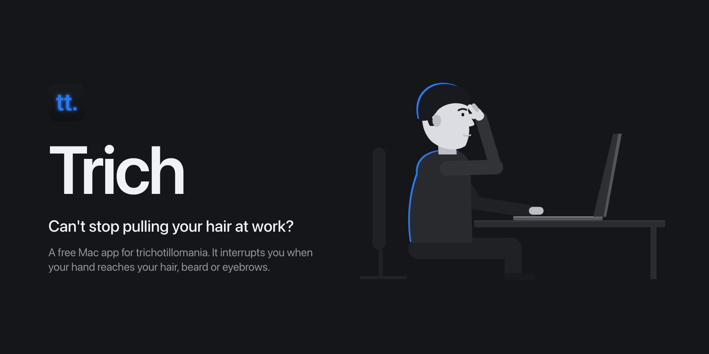
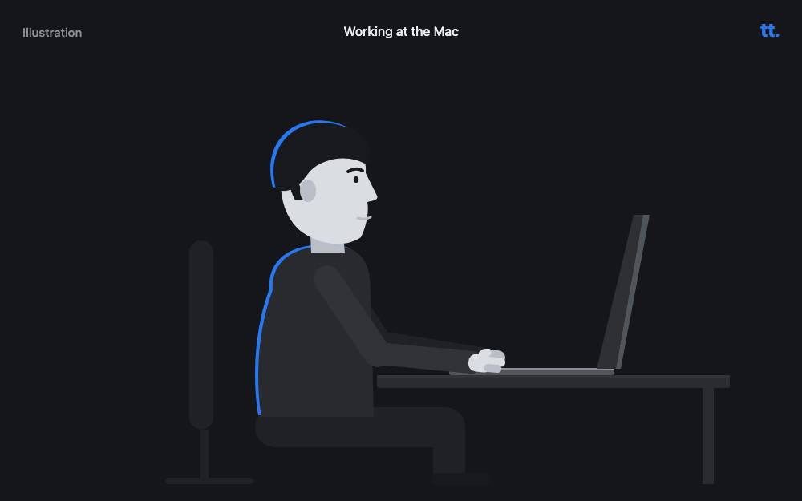

  

  <a href="https://github.com/ahmedkhudairr/Trich/releases/latest"><b>Download for Mac</b></a>

Hi, I'm Ahmed 👋 I'm a doctor, and I pulled at my beard for more than a year and a half. My hand would go there before I noticed. So I built Trich, a free Mac app that interrupts you the moment your hand reaches for it. After about 7 to 10 days my pulling dropped by almost 90% and I turned it off. That's my experience, not medical advice, and it might not work the same for you.

## How it works

1. **Pick where you pull.** Beard, eyebrows, scalp, or all three.
2. **Turn it on and get to work.** Trich watches through your Mac's camera.
3. **Your hand goes there.** A calm blue screen covers your displays.
4. **Take a breath.** Hold both Shift keys for 3 seconds, or wait 15.

  

## Privacy

Everything runs on your Mac. Camera frames are checked in memory with Apple's Vision framework and thrown away. No recording, no internet, no account, no analytics. Only your settings and the time of each reminder are saved, for up to 90 days. The whole app is Swift in [`Trich/`](Trich) with no third-party packages, so you can read every line.

## Install

1. Download the DMG from the [latest release](https://github.com/ahmedkhudairr/Trich/releases/latest).
2. Open it and drag **Trich** onto **Applications**.
3. Open Trich, finish the short intro and allow camera access.

Needs macOS 14 or newer. It's signed and notarized by Apple.

## Good to know

- Beard is the most tested. Eyebrows and scalp are newer, so treat them as early.
- Detection is an estimate. It can miss a touch or go off when you rest your chin on your hand. **Detection → Sensitivity** helps.
- Trich is an awareness tool, not a treatment. If pulling affects your life, please talk to a doctor or therapist.
- It's built to be needed for a while, then turned off. That's what happened for me.

## FAQ

**Does it record or upload video?** No. Frames are analysed in memory and thrown away, and the app never touches the internet.

**Why no close button?** It's on purpose. A button is too easy to click on autopilot. Holding both Shift keys gets your hands off your face, and it always closes by itself after 15 seconds.

**Will it pop up during video calls?** Yes, if your hand is at an area you picked. Turn it off first with **Detection → Turn Off**. It pauses on its own when your Mac sleeps or locks.

**The camera light is on. Is that normal?** Yes. The camera is only on while detection is on.

**It misses my hand, or goes off when I'm not pulling.** Face the built-in camera, keep your face and hands well inside the frame, and try **Detection → Sensitivity**.

**Can it start when I log in?** Yes, choose **Start at Login** from the tt. icon in the menu bar.

**How do I uninstall it?** Quit Trich and drag it from Applications to the Trash. To also clear its saved settings, run `defaults delete io.github.ahmedkhudairr.trich` in Terminal.

**Can I fork it or sell it?** Yes. MIT license, go for it.

## Build it yourself

Open `Trich.xcodeproj` in Xcode and run the **Trich** scheme.

## License

[MIT](LICENSE). Made with ❤️ by Ahmed.
